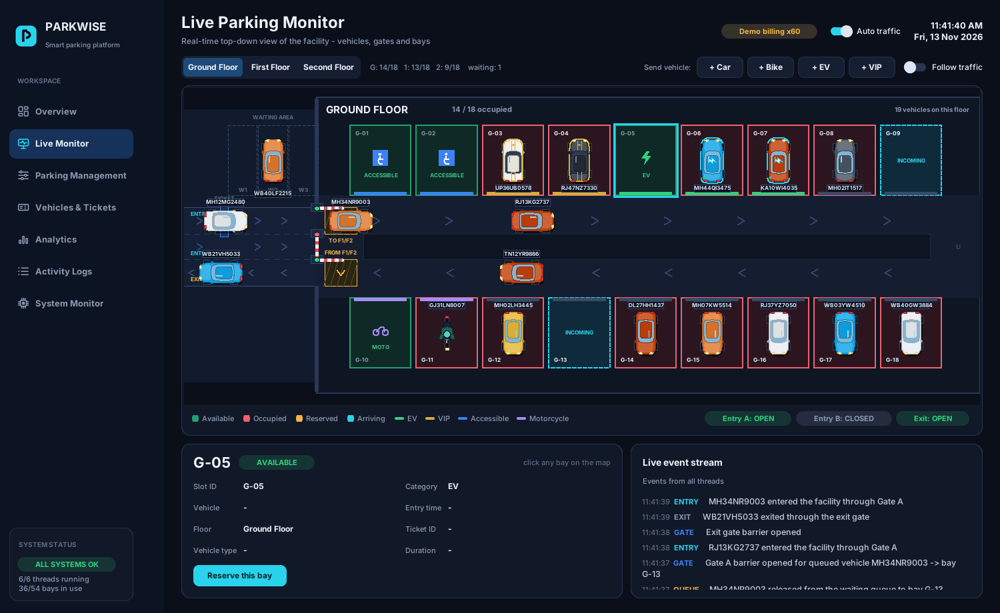

# PARKWISE - Smart Parking Management System

A multi-threaded smart-parking control platform for a three-floor garage (54 bays) with a
**live top-down vehicle simulation**, rule-based bay allocation, billing with PDF tickets and
receipts, SQLite persistence and a premium dark CustomTkinter interface.

| | |
|---|---|
| Language / GUI | Python 3.10+ / CustomTkinter + Tkinter Canvas |
| Concurrency | `threading` (6 worker threads), `queue.Queue`, `threading.Event`, `RLock` |
| Database | SQLite (WAL mode) |
| Charts / PDF | Matplotlib / ReportLab |




## 1. Installation

```bash
# Python 3.10 or newer with Tk (Windows/macOS installers include it)
python -m venv .venv
.venv\Scripts\activate            # Windows        (macOS/Linux: source .venv/bin/activate)
pip install -r requirements.txt
python main.py
```

Linux only: Tk is a separate package -> `sudo apt install python3-tk`.

The database (`data/parking.db`) is created automatically on first launch.
Close and reopen the application at any time - vehicles, bays, tickets, bills, reservations,
the waiting queue and logs are restored, and the parked vehicles reappear in their bays.

## 2. What you get

| Page | What it does |
|---|---|
| **Overview** | 10 live KPIs (capacity, occupied, available, occupancy %, entered, exited, revenue, active sessions, queue, reserved), occupancy gauge, per-floor bars, clickable 54-bay minimap, recent activity |
| **Live Monitor** | Real-time top-down garage. Cars, EVs, VIPs and motorcycles drive from the road through the entry barrier, along lanes, up the ramp to floors 1-2 and into their bay; on checkout they reverse out and leave through the exit barrier. Floor switching, "follow traffic", click any bay for details (slot, floor, status, vehicle, type, entry time, ticket, live duration) |
| **Parking Management** | Register a vehicle, choose category / colour / gate / bay (automatic or manual), reserve a bay (with expiry), release a bay, browse and filter all 54 bays, manage the waiting queue |
| **Vehicles & Tickets** | Searchable session table with live fee estimates, checkout with simulated UPI / card / cash, **ticket PDF** (with QR) and **receipt PDF**, CSV export |
| **Analytics** | 7 charts + KPIs from the database: occupancy trend, vehicle categories, floor occupancy, entries vs exits, revenue, peak hours, average duration; selectable time range |
| **Activity Logs** | Every event (detected, allocated, gate opened, entered, parked, full, queued, checkout, payment, released, exited) with the thread that raised it; filter, search, export |
| **System Monitor** | Live status of all 6 threads (start/stop each), queue depths, lock-contention statistics, DB integrity check, traffic profile, billing time-scale, stress test, data reset |

### Allocation rules
* **CAR** -> general bays only. **BIKE** -> motorcycle bays, then general. **EV** -> charging bays, then general. **VIP** -> VIP bays, then general; VIPs also jump the waiting queue.
* **Accessible** bays are given only to vehicles flagged as permit holders.
* **Reserved** bays are protected: only the reserved registration can use them; reservations expire.
* Nearest bay first (lowest floor, then bay number). When nothing suitable is free the vehicle waits in the waiting area (max 3); when a bay is released the queue is served automatically (a waiting car never blocks a bike that fits).
* Duplicate registrations are rejected (also enforced by SQLite unique indexes).

### Billing
`hours = max(1, ceil((minutes - 5) / 60))`, free inside the 5-minute grace period, per-hour rate by type
(Car 40, Bike 20, EV 50, VIP 60 INR) + 18 % GST. Payment is **simulated** - no real payment provider is used.

> **Demo billing time-scale.** A demo parks for seconds, not hours. The default `x60` bills one real second as
> one minute so revenue charts are meaningful. It is always shown in the top bar, printed on receipts and can be set
> to `x1` (real time) on the System Monitor page.

## 3. Project structure

```
main.py                      entry point
config.py                    layout, pricing, theme, traffic profiles
core/                        BUSINESS LOGIC (no Tkinter)
  parking_manager.py         shared state, allocation transactions, queue, reservations, lifecycle
  allocation.py              pure allocation engine (tiers, eligibility, reserved-bay protection)
  billing.py                 fee calculation
  database.py                SQLite schema, transactions, v1 -> v2 migration
  thread_manager.py          the 6 worker threads + lifecycle manager + message routing
  analytics.py               SQL-based analytics
  documents.py               ticket / receipt PDFs (ReportLab)
  locks.py                   RLock wrapper that records contention statistics
  gate_workers.py            compatibility shim for the v1 module name
simulation/                  VEHICLE SIMULATION (no Tkinter)
  layout.py                  facility geometry, rounded lane paths, routes
  vehicle_sim.py             kinematics, collision avoidance, barriers, ramps, events
  vehicle_art.py             top-view car / EV / VIP / motorcycle drawings
  traffic.py                 random plates and vehicles
gui/                         PRESENTATION
  app.py  theme.py  icons.py  widgets.py  charts.py
  facility_view.py           the live garage canvas
  parking_map.py             minimap
  pages/                     overview, monitor, management, tickets, analytics, logs, system
tests/                       54 automated tests
tools/capture_screenshots.py demo session + screenshots
docs/                        ARCHITECTURE.md, MULTITHREADING.md, screenshots/
```

Detailed design: [docs/ARCHITECTURE.md](docs/ARCHITECTURE.md) - threading: [docs/MULTITHREADING.md](docs/MULTITHREADING.md) -
what changed from v1: [UPGRADE_NOTES.md](UPGRADE_NOTES.md) - viva: [VIVA_PREPARATION.md](VIVA_PREPARATION.md).

## 4. Database setup

Nothing to install: SQLite ships with Python. `core/database.py` creates all tables and indexes on first run
(`settings, vehicles, slots, sessions, tickets, bills, reservations, queue, events, occupancy_samples`).

* Location: `data/parking.db` (change `DB_PATH` in `config.py`). To start fresh, delete the file (and `-wal`/`-shm`) or use **System Monitor -> Reset all data**.
* Inspect: `sqlite3 data/parking.db ".tables"` or any SQLite browser.
* **Upgrading a v1 database:** the old `tickets`/`events` tables are renamed to `legacy_tickets_v1` / `legacy_events_v1` (never deleted) and finished tickets are imported as history.

## 5. Testing

```bash
python -m unittest discover -s tests -v                       # everything (needs a display for the GUI tests)
python -m unittest tests.test_parking tests.test_simulation   # back-end + simulation, no display needed
xvfb-run -a python -m unittest tests.test_gui_smoke           # GUI tests on a headless Linux box
python -m pytest tests                                         # also works if pytest is installed
```
`tests/test_parking.py` (39 tests): allocation rules, duplicates, DB constraints, **concurrent allocation**, full queue and VIP priority,
reservations, billing, lifecycle, persistence, legacy migration, analytics.
`tests/test_simulation.py` (11): the simulation drives the real backend, ramps, waiting area, **restart recovery**, **6-thread
start/stop/restart/shutdown**, end-to-end with real threads, 25 s of automatic rush-hour traffic with consistency checks.
`tests/test_gui_smoke.py` (4): every page opens, registering / reserving / checkout / release through the real widgets,
receipt PDF written by the billing thread, bay click + floor switch, full application restart.

Regenerate the screenshots: `python tools/capture_screenshots.py`.

## 6. Configuration
Everything in `config.py`: bay categories per floor, rates, grace period, GST, billing time-scale options,
traffic profiles (arrival rates, stay times), vehicle mix, waiting-area size.

## 7. Known limitations (honest list)
* Arrivals, payments and gates are simulated - no cameras, sensors, barriers or payment gateway are connected.
* The ticket "print" button opens the PDF in your default viewer (print from there).
* The simulation is a 2-D kinematic model, not a physics engine; in extreme congestion a vehicle may wait several seconds for another to clear.
* Single user, single machine (SQLite + in-process threads).
